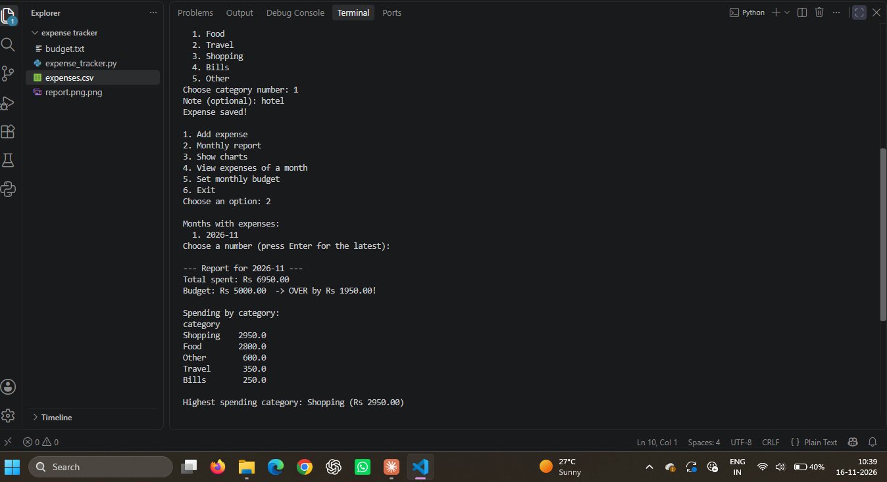
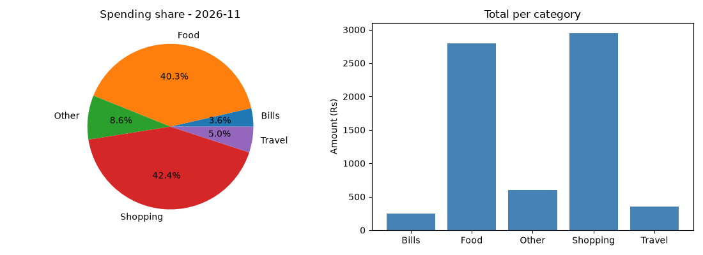

# Personal Expense Tracker

A command-line Python app to record daily expenses, track a monthly
budget, and visualize spending.

## Features
- Add expenses with amount, category and note (saved in CSV)
- Set your own monthly budget with overspending alerts
- Monthly report: total spent, category breakdown, highest category
- View all expenses of any previous month
- Month-over-month spending comparison
- Pie and bar charts using Matplotlib

## Tech Used
Python, pandas, Matplotlib

## How to Run
pip install pandas matplotlib
python expense_tracker.py

## Screenshots

## Future Improvements
- Delete or edit expenses
- Web interface with Streamlit
- Auto-categorization using machine learning